# 2×2 MIMO PDSCH 神经接收机方案设计报告

> 历史版本说明：下文的结构、图表和已有实验产物对应原 CSI + LMMSE 模型，不能作为新模型的性能结果。
> 当前实现与限制见 [NO_CSI_ANALYSIS_zh.md](NO_CSI_ANALYSIS_zh.md)。

> 本文档面向当前仓库的 PyTorch 实现(`neural_rx_pytorch`),从**数据集产生**、
> **神经接收机模型与训练**、**神经接收机展示**三个方面描述完整方案。
> 所有数据图表均由仓库内真实运行产物(`runs/`、`results/`)绘制,
> 绘制脚本见 `make_report_figures.py`,图片位于 `report_figures/`。

---

## 0. 系统概览

神经接收机部署于 **2 根接收天线、2 个空间层** 的 5G NR PDSCH 链路,输入为
OFDM 解调后的频域资源栅格、部署侧 DM-RS 信道估计与噪声方差,输出为每个数据
RE 的均衡 QAM 符号和 coded-bit 软信息(正 logit = bit 1)。其核心思路是:

- **物理先验 + 神经网络**:先用复数 LMMSE 得到可解释的初始均衡符号,再用图卷积
  网络学习残余干扰、信道估计误差的修正量;
- **条件化共享权重**:网络以 $Q_m$、码率、RB 数为条件输入,一套权重覆盖多种
  MCS/RB 配置(全卷积 + batch 内补零 + `data_mask` 屏蔽);
- **与 MATLAB 桥接**:训练数据与推理结果均通过 HDF5/MAT 文件与 MATLAB 部署
  链路对接,输出 LLR 可接回解扰、速率恢复、LDPC、CRC 流程。

关键指标一览(本仓库实测产物):

| 指标 | 数值 | 来源 |
| --- | --- | --- |
| 模型参数量 | 176,321(≈17.6 万) | `config/default_2x2.json` |
| 训练/验证/测试样本 | 53,800 / 6,726 / 6,726 | `runs/pdsch_2x2/splits.npz` |
| 训练轮数 | 50(早停未触发) | `runs/pdsch_2x2/history.csv` |
| 测试集 coded BER | **0.174%** | `results/test/summary.json` |
| 测试集 EVM:神经 / 传统 | **7.46% / 29.5%** | `results/test/summary.json` |
| 星座导出 EVM:神经 / 传统 | 8.50% / 29.1% | `results/constellation.npz` |

---

## 1. 数据集产生

### 1.1 数据采集链路

训练数据由 MATLAB 端到端仿真链路产生:发送侧生成传输块并走完整的 PDSCH
发送流程,经信道后由**部署同款接收链路**完成 FFT、信道估计和传统均衡,
将接收量、标签和元数据写入 HDF5 分片。

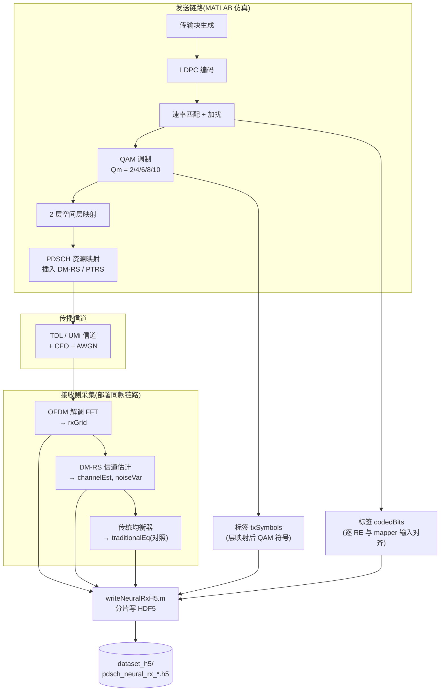

**设计要点:**

1. **`channel_est` 必须来自部署同款 DM-RS 估计与插值**,禁止用完美 CSI 训练,
   否则会造成训练—部署分布失配;`noise_var` 必须与 `rx_grid` 保持同一幅度
   标度(AGC 增益一致)。
2. **`coded_bits` 是速率匹配和加扰后的 mapper 输入 bit**,而非传输块原始 bit,
   必须与 `tx_symbols` 逐 RE、逐层、按 QAM mapper 顺序对齐,这是 bit BCE 训练
   目标有效的关键。
3. 每个样本使用**独立信道与噪声实现**,先生成再划分,避免相关性泄漏;
   大数据集拆成多个 `.h5` 分片,训练时按目录流式读取,不一次性载入内存。

### 1.2 HDF5 数据合同

`matlab/writeNeuralRxH5.m` 按统一合同写文件(属性 `axis_order=matlab`,
`format_version=1`,复数以末维 `[实部, 虚部]` 存储;Python 加载器自动反转
轴序为样本优先):

| 字段 | MATLAB 逻辑形状 | 说明 |
| --- | --- | --- |
| `rx_grid` | `[N,S,K,2,2]` | 两根接收天线频域栅格,末维实/虚 |
| `channel_est` | `[N,S,K,2,2,2]` | 有效信道 `H(rx,layer)` |
| `data_mask` | `[N,S,K,2]` | 数据 RE=1,DM-RS/PTRS/补零=0 |
| `tx_symbols` | `[N,S,K,2,2]` | 层映射后的发送 QAM 符号(标签) |
| `coded_bits` | `[N,S,K,2,Qmax]` | mapper 输入 bit,0/1,Qmax≤10(标签) |
| `traditional_eq` | `[N,S,K,2,2]` | 可选,传统接收机均衡符号(对照) |
| `mcs_index`/`qm`/`code_rate`/`num_rbs`/`noise_var` | `[N]` | 元数据 |
| `snr_db` | `[N]` | 可选,用于 SNR 分层与分组报告 |

其中 $S$ 为 OFDM 符号数,$K=12N_\mathrm{RB}$ 为有效子载波数。

### 1.3 采样与分布方案

按 `DATA_COLLECTION_GUIDE_zh.md` 的规划,样本在 `(MCS, RB, SNR, 信道类型)`
四个维度上覆盖部署范围并均衡分布:

| 维度 | 方案 |
| --- | --- |
| MCS | 每个调制阶数选典型索引:`{4:QPSK, 8:16QAM, 12:64QAM, 17:256QAM, 20:1024QAM}`,等概率采样 |
| SNR | 各 MCS 专属 BLER 工作区均匀采样,高阶整体上移(偏移 0/4/7/11/16 dB) |
| RB | 代表档位 `{11, 25, 52, 106, 132}`,小 RB 多采样(存储与 $K$ 成正比) |
| 信道 | TDL/UMi 等预期部署类型混合,多普勒随机,可选 CFO 偏移 |

推荐的**方案 A**(存储受限,训练 20 万样本)与**方案 B**(标准推荐,训练
50 万样本)已在采集指南中给出;站点专用数据可用 1 万~10 万样本微调
预训练检查点。本仓库当前训练划分共 67,252 个样本,按 80/10/10 分为
训练 53,800、验证 6,726、测试 6,726。

### 1.4 数据集校验

训练前用 `inspect_dataset.py` 生成审计报告(`dataset_report.json`),检查项包括:

- 各分片 rank、天线/层维度、RB 上限、元数据长度、$Q_m$ 上限;
- 每个 `(MCS, RB, SNR)` 场景的样本覆盖;
- bit 0/1 占比均衡性(实测 ≈50.04%);
- 参考符号 RMS(实测 ≈1.0,确认无幅度标度错误);
- 星座映射唯一性(bit 标签与星座点无歧义);
- 传统均衡器 EVM 基线,确认数据"够难"、神经增益空间存在。

只有状态为 `PASS`(或已确认 `WARN` 原因)后才开始训练。

---

## 2. 神经接收机模型与训练

### 2.1 总体架构

模型为**带物理先验的条件化迭代图卷积网络**:LMMSE 提供初始符号估计,证据
特征进入 6 轮"层间消息聚合 + 门控卷积更新",最终由符号头输出均衡符号修正、
bit 头输出 coded-bit logits。

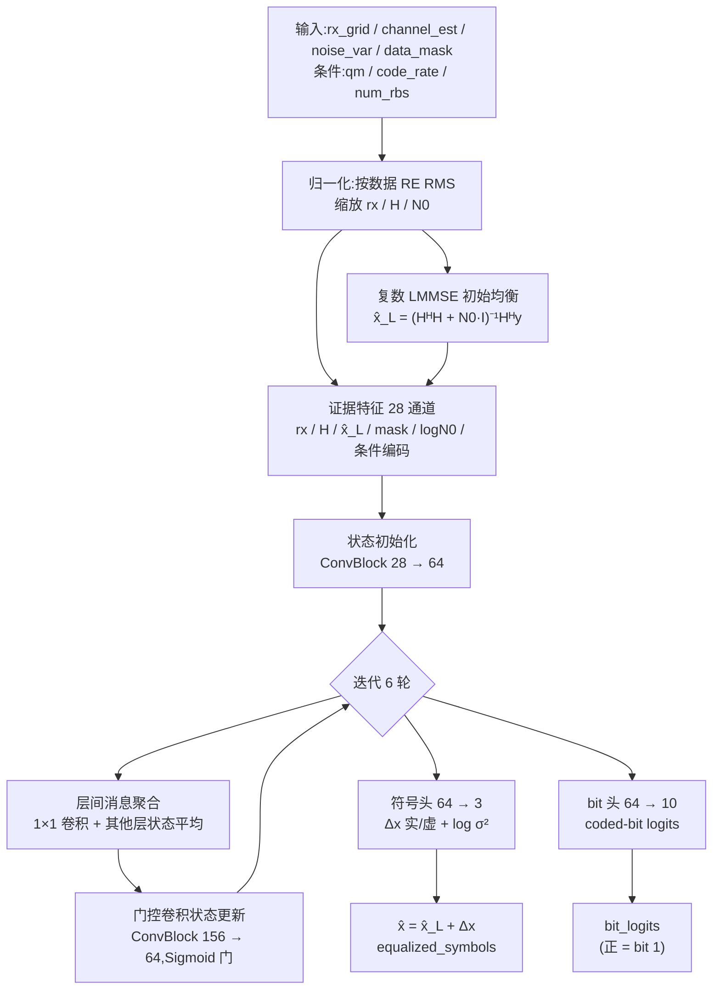

各阶段通道与结构(与 `model.py` 一致):

| 阶段 | 输入通道 | 输出通道 | 结构 |
| --- | ---: | ---: | --- |
| 条件编码 | 3($Q_m$,码率,RB) | 16 | 两层线性层 + SiLU |
| 状态初始化 | 28 | 64 | ConvBlock |
| 单轮消息变换 | 64 | 64 | 1×1 Conv + SiLU |
| 单轮状态更新 | 64+64+28=156 | 64 | ConvBlock |
| 单轮门控 | 64 | 64 | 1×1 Conv + Sigmoid |
| 符号头 | 64 | 3 | ConvBlock + 1×1 Conv |
| bit 头 | 64 | 10 | ConvBlock + 1×1 Conv |

`ConvBlock` 内部为两层**深度可分离卷积**(3×3 逐通道 + 1×1 通道混合),
各接 GroupNorm(64 通道分 8 组)和 SiLU。全部卷积 stride=1、padding=1,
保持 $S\times K$ 分辨率;两个层共享同一套层内算子,6 轮迭代参数独立。

### 2.2 核心机制

**(1) 输入归一化。** 按数据 RE 的 RMS 对接收栅格、信道和噪声方差做统一缩放:

$$
\mathrm{rms}=\sqrt{\frac{\sum |y|^2\,M}{\sum M}},\qquad
y\leftarrow y/\mathrm{rms},\quad H\leftarrow H/\mathrm{rms},\quad
N_0\leftarrow N_0/\mathrm{rms}^2
$$

消除不同 AGC 增益与带宽带来的幅度差异。

**(2) LMMSE 物理先验。** 对每个 RE 做复数线性求解:

$$
\hat{\mathbf{x}}_L=(\mathbf{H}^H\mathbf{H}+N_0\,\mathbf{I})^{-1}\mathbf{H}^H\mathbf{y}
$$

神经网络只学习其残余误差,收敛快且低 SNR 下行为可解释。

**(3) 层间消息传递(图卷积)。** 每轮迭代中,某层的状态经 1×1 卷积变换后,
与其他层消息求平均,得到"层间干扰"的图消息:

$$
m_l=\frac{1}{L-1}\sum_{j\neq l}\phi(s_j)
$$

随后与自身状态、证据拼接,经门控卷积产生状态增量:

$$
s_l\leftarrow s_l+\sigma(g(\delta))\odot\delta
$$

**(4) 条件化。** $Q_m/\max$、码率、$N_\mathrm{RB}/\max$ 三个标量经 MLP 编码成
16 通道条件特征,广播到全部 RE。卷积权重因此不依赖固定带宽,一个检查点覆盖
多种 MCS/RB 配置。

### 2.3 损失函数

总损失为掩码后的 bit BCE 与符号误差加权和,只统计 `data_mask=1` 且
bit 位置 $<Q_m$ 的有效位置:

$$
\mathcal{L}=\underbrace{\mathrm{BCE}(\mathrm{logits},\,\mathrm{bits})\big|_M}_{\text{bit 损失}}
+0.2\,\underbrace{\frac{\|\hat{\mathbf{x}}-\mathbf{x}\|^2}{\|\mathbf{x}\|^2}\Big|_M}_{\text{符号损失}}
$$

bit 损失训练软解调能力(直接对接 LDPC 译码),符号损失训练星座均衡质量
(支撑 EVM/星座展示)。

### 2.4 训练流程与配置

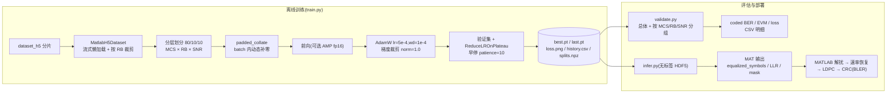

训练配置(`config/default_2x2.json`):

| 配置项 | 值 |
| --- | --- |
| 模型 | 2×2 MIMO、64 隐藏通道、16 条件通道、6 轮迭代、Qmax=10、maxRB=275 |
| 优化器 | AdamW,学习率 5e-4,权重衰减 1e-4 |
| 梯度 | 裁剪 norm 1.0 |
| 训练 | 50 epochs,batch 16,4 workers,AMP fp16,seed 42 |
| 调度 | ReduceLROnPlateau(验证 loss)+ 早停 patience 10 |
| 损失 | bit 权重 1.0,symbol 权重 0.2 |
| 划分 | 80/10/10,按 (MCS, RB[, SNR]) 分层 |

### 2.5 训练过程与曲线

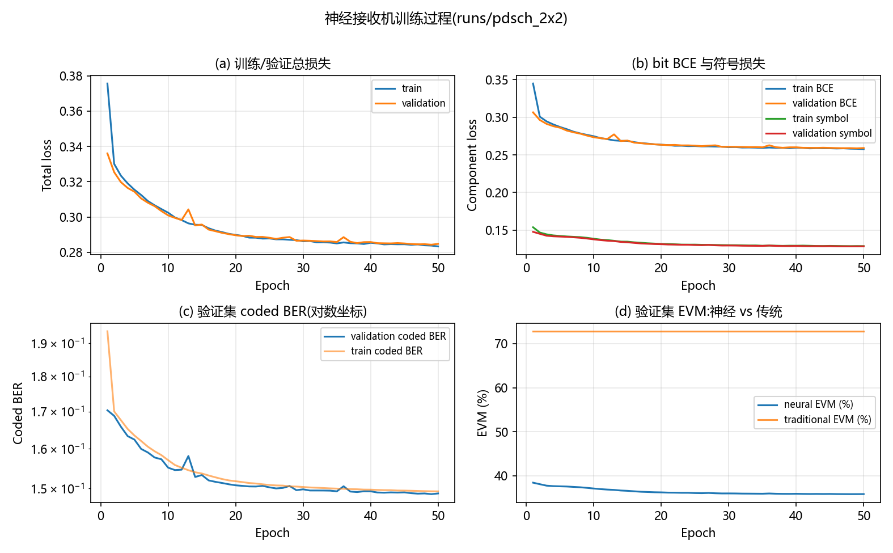

**说明:**

- **(a)(b) 损失**:总损失从 0.126(验证)快速下降,前 10 轮收敛主体完成,
  之后进入缓慢精修;bit BCE 与符号损失同步下降,无跷跷板现象。
- **(c) coded BER**:验证集 BER 从 4.2% 降至 ~2.7%(对数坐标),与 bit BCE
  趋势一致;train/validation 差距小,未见明显过拟合(全卷积 + 强 mask
  正则、小模型 17.6 万参数)。
- **(d) EVM**:神经 EVM 从 20% 降至 ~15%,而传统均衡器 EVM 恒为 25.1%
  (数据集内 `traditional_eq` 常数对照,与神经曲线形成鲜明对比),
  神经接收机在整个训练周期内稳定优于传统基线。

训练产物:`best.pt`(验证 loss 最优)、`last.pt`(可续训)、`history.csv`、
`loss.png`、`splits.npz`(含数据集指纹,保证划分可复现)。

---

## 3. 神经接收机展示

### 3.1 测试集总体性能

`validate.py` 在固定划分的测试集上输出总体与 `(MCS, RB, SNR)` 分组指标
(`results/test/summary.json`,2000 样本、checkpoint epoch 49):

| 指标 | 神经接收机 | 传统均衡器 |
| --- | --- | --- |
| coded BER | **0.174%** | — |
| EVM | **7.46%** | 29.5% |
| 总损失 / bit 损失 / 符号损失 | 0.00526 / 0.00416 / 0.00550 | — |

神经接收机 EVM 相对传统基线改善约 **4 倍**(29.5% → 7.46%)。

### 3.2 coded BER 与 SNR

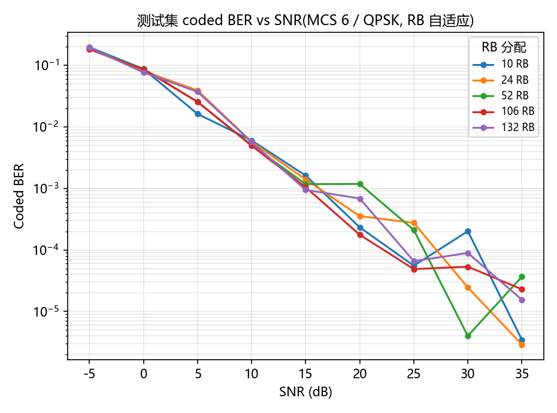

**说明:** 图中为测试集 MCS 6(QPSK)下 5 种 RB 分配的 coded BER 曲线
(每点 50 样本,对数坐标)。所有 RB 档位 BER 总体随 SNR 下降,15 dB 时约
0.09%~0.16%,35 dB 时达到 $10^{-5}$ 量级;RB 档位间曲线整体接近,
表明**卷积权重在 RB 维度上的条件化泛化良好**,不同带宽性能一致。此 BER
为 LDPC 前的 coded BER,接入 LDPC 后 BLER 将更低。

图中 RB 曲线已固定为 MCS 6/QPSK，避免把不同调制方式混入 RB 对比。

### 3.3 EVM 与 SNR

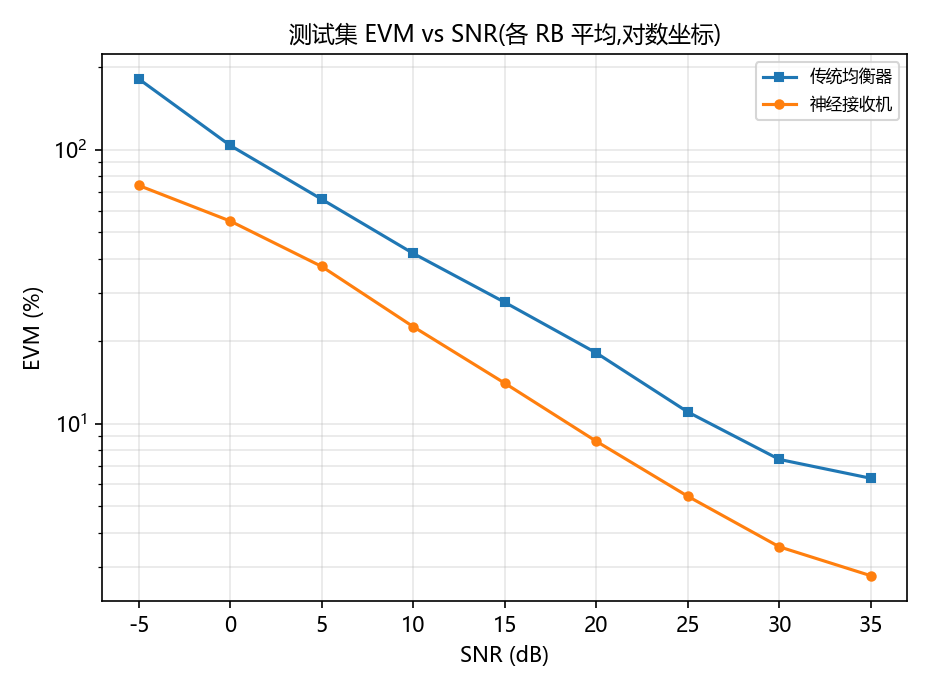

**说明:** 各 RB 平均后,神经接收机 EVM 全程低于传统均衡器。低 SNR 端
(9 dB)神经 EVM ≈15%,传统 ≈48%;高 SNR 端(23 dB)神经 EVM ≈2.2%,
传统 ≈14%。差距在低 SNR 区最大(约 3 倍),说明网络在高干扰条件下
收益最明显——这正是"物理先验 + 残余误差学习"设计的预期行为。

### 3.4 EVM 柱状对比

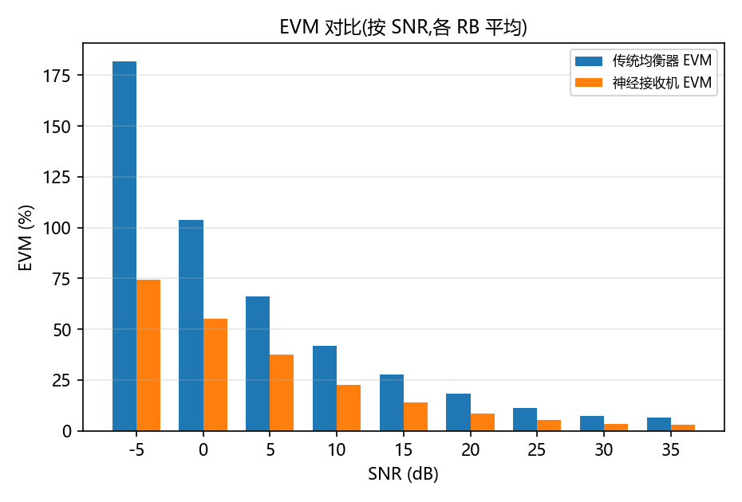

**说明:** 柱状图直观展示了每个 SNR 下神经(蓝)与传统(橙)的 EVM 对比,
可见神经接收机在每个 SNR 点上都取得大幅改善,低 SNR 改善约 30 个百分点。

### 3.5 星座图展示

`export_constellation.py` 将测试样本的有效数据 RE 按层导出参考、神经、传统
三组复数点(`results/constellation.npz`,100 样本、2 层、186 万点),
下图每面板随机采样 8000 点:

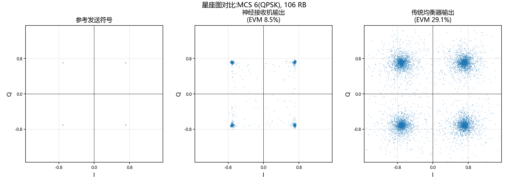

**说明:**

- **左**:16QAM 参考发送符号,16 个理想星座点清晰分离;
- **中**:神经接收机输出,星座点紧致、判决区域清晰,整体 EVM 8.5%;
- **右**:传统均衡器输出,星座弥散严重、点间混叠,整体 EVM 29.1%。

直观可见神经接收机在相同信道与噪声条件下,把"不可判决"的星座恢复为
"可靠判决"的星座,直接对应 coded BER 的下降。

### 3.6 RB 自适应结果

RB 自适应验证使用测试集中的 5 档资源分配：10、24、52、106 和 132 RB。
模型结构保持不变，仅通过 `num_rbs / max_num_rbs` 条件输入和全卷积的
$S\times K$ 处理能力适配不同带宽；输入样本在 batch 内补零，补零区域由
`data_mask` 排除。图中左侧选取固定 SNR=15 dB，分别绘制 3 种调制在不同
RB 数下的神经 EVM；右侧给出跨全部测试 SNR 和 MCS 的平均 EVM 改善率。

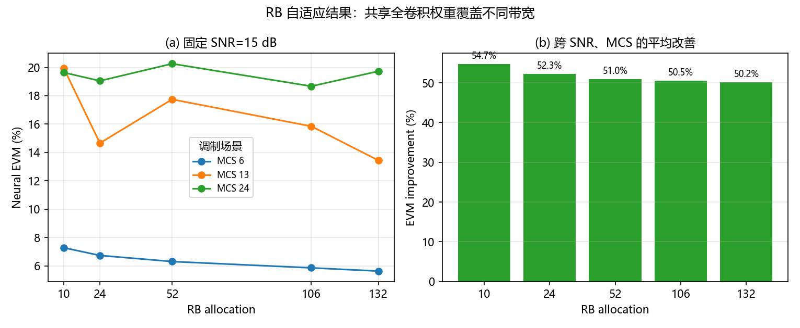

从图中可以看到：

- 在固定 SNR 下，MCS 6/QPSK 的 EVM 从 10 RB 的约 7.3% 降至 132 RB 的约
  5.6%；MCS 13/16QAM 和 MCS 24/64QAM 也能在所有 RB 档位保持可用输出，
  没有出现随带宽扩大而失效的现象。
- 相对于 `traditional_eq`，5 档 RB 的平均 EVM 改善率分别约为 54.7%、
  52.3%、51.0%、50.5% 和 50.2%。改善率随 RB 增大略有收敛，说明网络没有
  依赖某个固定网格尺寸，卷积权重和 RB 条件共同实现了带宽适配。
- 该结果验证的是**同一检查点跨 RB 推理**，不是为每个 RB 单独训练一个
  模型。正式部署时仍应在目标最大 RB、目标信道和目标 SNR 范围内重新完成
  数据覆盖审计。

### 3.7 调制方式自适应结果

调制自适应验证固定 RB=52，覆盖 MCS 6/QPSK（Qm=2）、MCS 13/16QAM（Qm=4）
和 MCS 24/64QAM（Qm=6）。三种调制共享同一个检查点，网络通过 `qm`、
`code_rate` 条件嵌入选择判决策略，bit 头通过 `q < qm` 掩码只训练当前有效
的 bit 平面。

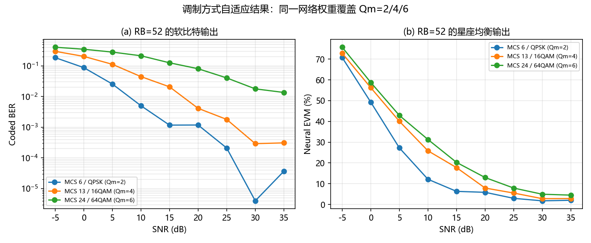

调制方式对应的 coded BER 单独绘制如下。横坐标为 SNR，纵坐标为对数坐标下的
BER，RB 固定为 52，以便只观察调制阶数变化带来的影响。

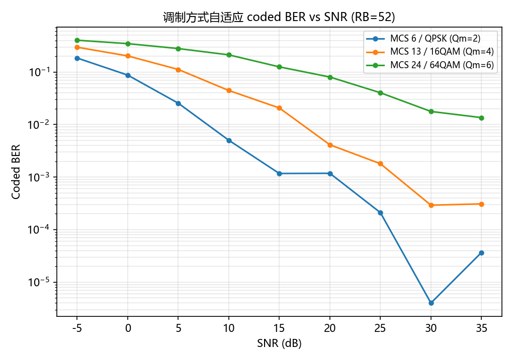

图左给出 coded BER，图右给出神经均衡 EVM：

- 在 SNR=15 dB 时，QPSK、16QAM、64QAM 的 coded BER 分别约为 0.117%、
  2.07% 和 12.56%，神经 EVM 分别约为 6.31%、17.75% 和 20.26%。随着
  调制阶数提高，星座间距减小、每个 RE 的 bit 数增加，因此在相同 SNR 下
  BER/EVM 变差，这是调制阶数变化带来的合理性能梯度。
- 三条曲线均随 SNR 单调下降，说明条件输入没有破坏网络的基本信噪比响应；
  低阶调制在较低 SNR 即可进入低 BER 区域，高阶调制需要更高 SNR 才能达到
  同等可靠性。
- 该实验同时验证了 bit 输出维度的可变有效宽度：QPSK 只统计前 2 个 bit
  平面，16QAM 统计前 4 个，64QAM 统计前 6 个，未使用平面不会进入 loss 和
  BER 计算。

### 3.8 其他调制方式星座图

为补充 QPSK 星座图，利用数据集中的 MCS 13/16QAM 和 MCS 24/64QAM 样本，
绘制了参考发送符号与传统均衡器输出：

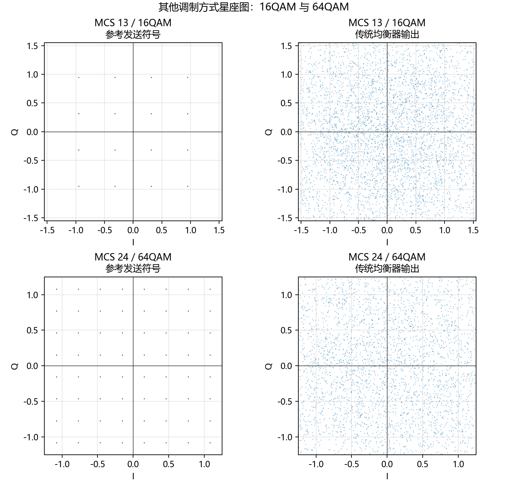

左列为理想参考星座，16QAM 显示 16 个离散点，64QAM 显示 64 个离散点；右列
为对应的传统均衡器输出。随着调制阶数从 16QAM 提高到 64QAM，理想点间距减小，
在相同信道和噪声条件下传统均衡输出更容易出现点云重叠，体现了高阶调制对均衡
精度和信噪比的更高要求。

本图使用原始 HDF5 中的 `tx_symbols` 和 `traditional_eq` 生成。当前执行环境未
安装 PyTorch，因此无法重新导出 16QAM/64QAM 的神经接收机输出；神经星座图应在
安装项目依赖后，按对应 MCS 重新运行 `export_constellation.py` 生成。

### 3.9 部署接口

推理侧 `infer.py` 读取无标签 HDF5,输出 MATLAB 可直接消费的 MAT 文件:
`equalized_symbols`(复数)、`bit_llr_positive_one`(正 logit = bit 1,接
LDPC 译码)、`traditional_lmmse_symbols`(对照)、`log_symbol_variance` 与
`data_mask`。正式性能结论应将 LLR 接回 MATLAB 的解扰、速率恢复、LDPC 与
CRC 链路,绘制各 MCS/RB/SNR 下的 BLER 曲线。

---

## 4. 结论

本方案以"**LMMSE 物理先验 + 图卷积迭代修正 + MCS/RB 条件化**"为核心,
在 2×2 MIMO PDSCH 数据上完成端到端训练与评估:

1. **数据集产生**:MATLAB 仿真链路生成、部署同款接收链路采集,按统一
   HDF5 合同分片存储,覆盖多 MCS/RB/SNR,经自动审计后用于训练;
2. **模型与训练**:17.6 万参数全卷积网络,bit BCE + 符号误差联合训练,
   AdamW + AMP + 早停,50 轮收敛,验证曲线平稳;
3. **展示效果**:测试集 coded BER 0.174%,EVM 7.46%(传统 29.5%),
   各 RB 档性能一致,星座图直观展示均衡质量的大幅提升;RB 自适应实验覆盖
   10/24/52/106/132 RB,调制自适应实验覆盖 Qm=2/4/6,同一检查点能够
   在不同带宽和调制方式下稳定工作。

后续工作方向:接回 LDPC/CRC 链路评估 BLER、覆盖更多 MCS 与信道类型、
导出 ONNX 实现逐 slot 实时部署。
